# WordTemplateBundle

[](https://github.com/nowo-tech/WordTemplateBundle/actions/workflows/ci.yml) [](https://packagist.org/packages/nowo-tech/word-template-bundle) [](https://packagist.org/packages/nowo-tech/word-template-bundle) [](LICENSE) [](https://php.net) [](https://symfony.com) [](https://github.com/nowo-tech/WordTemplateBundle) [](#tests-and-coverage)

> **Found this useful?** Install from Packagist (`composer require nowo-tech/word-template-bundle`) and consider starring [WordTemplateBundle on GitHub](https://github.com/nowo-tech/WordTemplateBundle).

Symfony bundle that fills **Microsoft Word `.docx` templates** (PHPWord [`TemplateProcessor`](https://phpoffice.github.io/PHPWord/docs/classes/PhpOffice-PhpWord-TemplateProcessor.html)) using a **PHP context array**:
- **Scalars** (strings, numbers, booleans, null) → `setValue` on placeholders such as `${client_name}` or `${client.city}` when you nest arrays (flattened to dot keys).
- **Expression conditionals** *(1.8, opt-in)* → `${#if total > 1000}` … `${#endif}`: the condition lives in the template and is evaluated against the context (operators, `in`, `matches`, Twig-like functions such as `upper()`, `length()`, `date()`), sandboxed — see **[Conditionals](#conditionals)** below.
- **`ConditionalBlock`** → `${#if block}` … `${#endif block}` named regions (**several** sibling and **nested** blocks supported); show or remove from PHP. Markers split across Word runs are healed before apply. For named blocks you pass a `bool` — see **[Conditionals by data type](docs/USAGE.md#conditionals-by-data-type)** for how to derive it from `bool`, `int`, `float`, `string`, `null`, arrays, dates, enums, Doctrine relations and request/form data, the "else" and "one of N" patterns, and where markers may go in Word.
- **`TableRows`** → `cloneRow` + per-cell `#1`, `#2`, … replacements for repeating table lines (**several independent tables** in one `.docx` via distinct anchors; one `TableRows` per table row).
- **`HtmlContent`** → rich fragments (paragraphs, bold/italic, tables inside HTML, etc.) via PHPWord `Html::addHtml` embedded as a complex block (lists `<ul>`/`<ol>` may require extra numbering setup in PHPWord; prefer plain paragraphs or combine with [HtmlToWordBundle](https://github.com/nowo-tech/HtmlToWordBundle) for full HTML pipelines).
- **`ImageSource`** → `setImageValue` with optional width/height.
- **`listVariables()`** → unique paint placeholder names (includes fields inside conditionals; omits `#if` / `#endif` markers).
- **`listConditionalBlocks()`** → unique conditional block names (e.g. `annex` from `${#if annex}`).
- **`listConditionalExpressions()` / `lintConditionalExpressions()`** → list and validate the expression conditionals of a template before merging (e.g. on upload).
This bundle does **not** execute Word VBA macros; “macros” here means **template placeholders** in the `.docx` compatible with PHPWord.
Under FrankenPHP (especially **worker** mode), `process()` is bounded by a configurable **`timeout`** (default **180s**, cooperative deadline + `set_time_limit`) so a long merge cannot pin a worker forever. See [docs/CONFIGURATION.md](docs/CONFIGURATION.md) and [docs/DEMO-FRANKENPHP.md](docs/DEMO-FRANKENPHP.md) (**REQ-RUNTIME-001**). PHPWord globals touched during a merge (`Html` statics, output escaping) are saved and restored so the processor stays safe when the kernel is **not** reset between requests — see [docs/FRANKENPHP-WORKER-AUDIT.md](docs/FRANKENPHP-WORKER-AUDIT.md).

## Conditionals

Two ways to keep or remove part of a document — both in the same template if you like:

| | Named block (decided in PHP) | Expression (decided in the template, 1.8 opt-in) |
|---|---|---|
| **In Word** | `${#if annex}` … `${#endif annex}` | `${#if total > 1000}` … `${#endif}` |
| **In PHP** | `'annex' => new ConditionalBlock('annex', $hasAnnex)` | `'total' => $order->total()` |
| **Enable** | always on | `nowo_word_template.conditional_expressions.enabled: true` |

**In Word** (each marker in its own paragraph):

```text
Invoice ${number}
${#if total > 1000 and upper(country) == 'ES'}
Orders above 1,000 EUR ship for free within Spain.
${#endif}
${#if status != 'paid'}
Please pay before ${due_date}.
${#endif}
```

**In PHP:**

```php
$document = $processor->process($templatePath, [
    'number'   => 'F-2026-001',
    'total'    => 1500,
    'country'  => 'es',
    'status'   => InvoiceStatus::Overdue,          // backed enum → 'overdue'
    'due_date' => new DateTimeImmutable('2026-11-15'), // date → '2026-11-15'
]);
```

**Result:** `Invoice F-2026-001` · `Orders above 1,000 EUR ship for free within Spain.` · `Please pay before 2026-11-15.`

Expressions use [Symfony ExpressionLanguage](https://symfony.com/doc/current/components/expression_language.html) syntax with no access to PHP functions, constants or objects — only the context values and a whitelist of Twig-like functions (`lower`, `upper`, `trim`, `length`, `replace`, `round`, `number_format`, `join`, `default`, `is_defined`, `now`, `date`, …; your own via a tagged provider). Errors (typos, unknown variables) throw `ConditionalExpressionException` by default. Word's typographic quotes are handled. Full reference: [USAGE — Expression conditionals](docs/USAGE.md#expression-conditionals) (operators, data types, functions, nesting, "else", one of N, errors) and [USAGE — Conditionals by data type](docs/USAGE.md#conditionals-by-data-type) for named blocks.

Rendered by the demo (`make docx-previews`, LibreOffice) — template in Word → generated document:

| Expression true / false | Nested blocks | "Else" pair |
|---|---|---|
| [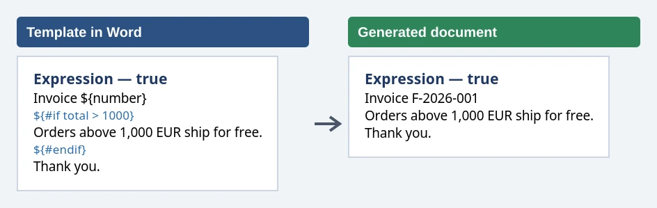](docs/images/demo/docx-expression-true.webp) [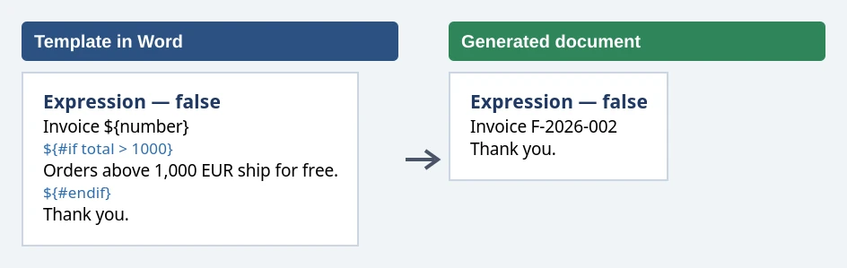](docs/images/demo/docx-expression-false.webp) | [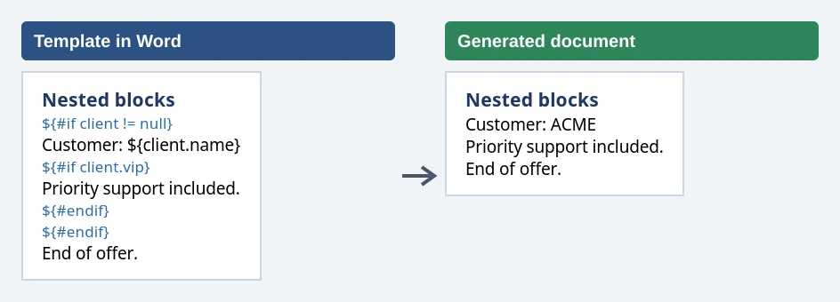](docs/images/demo/docx-nested.webp) | [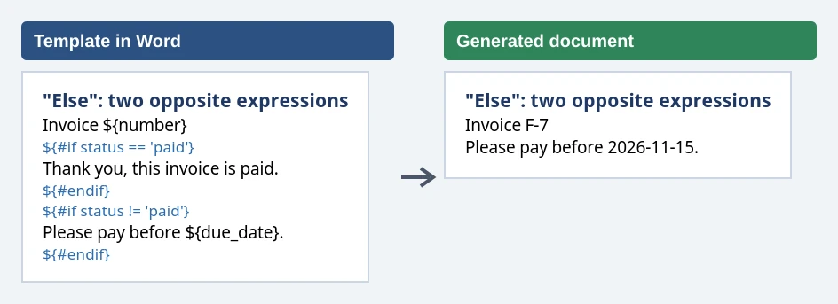](docs/images/demo/docx-else.webp) |
| **One of N** | **Table only when there are rows** | **Functions** |
| [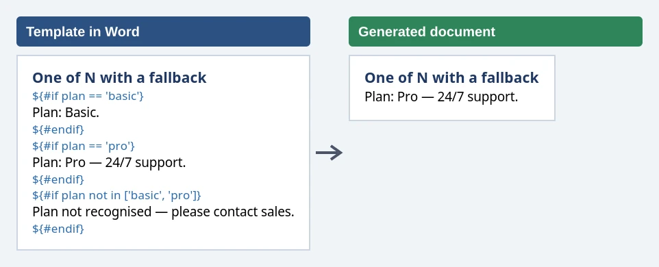](docs/images/demo/docx-one-of-n.webp) | [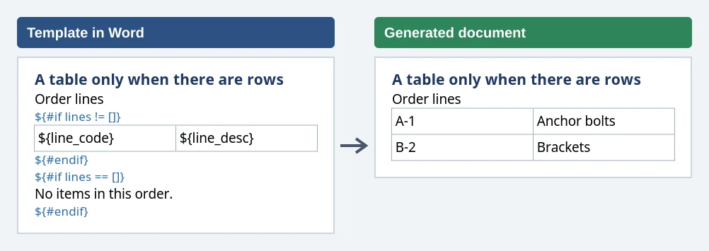](docs/images/demo/docx-table.webp) [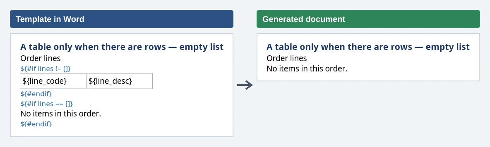](docs/images/demo/docx-table-empty.webp) | [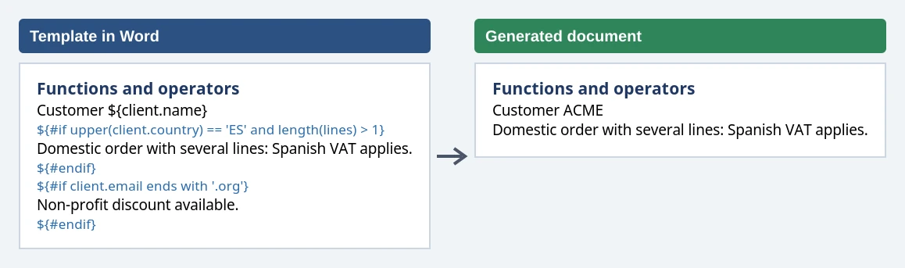](docs/images/demo/docx-functions.webp) |
| **Named block (PHP)** | **Dates** | |
| [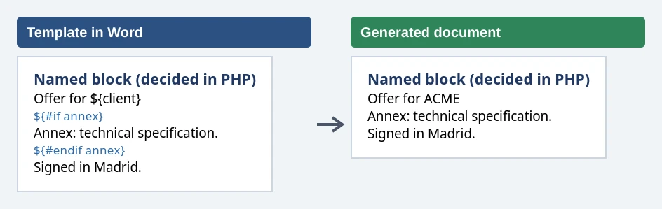](docs/images/demo/docx-named-block.webp) | [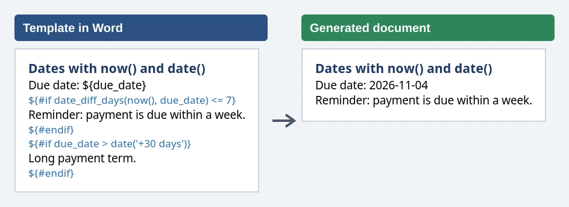](docs/images/demo/docx-dates.webp) | |

Demo pages (`demo/symfony8`):

| Template form | Conditionals (named + expression decisions) | Expression examples (Word / PHP / result) |
|---|---|---|
| [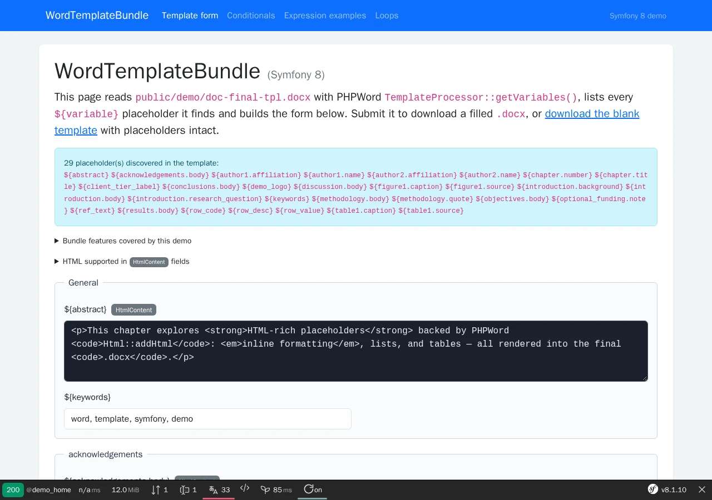](docs/images/demo/home.webp) | [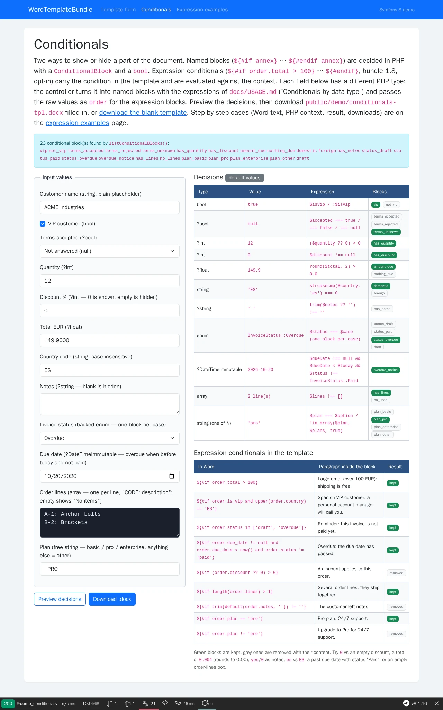](docs/images/demo/conditionals.webp) | [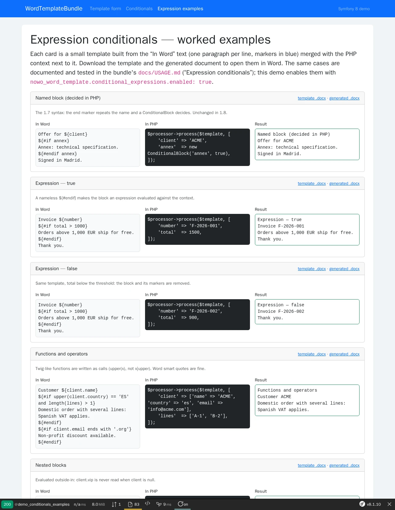](docs/images/demo/expression-examples.webp) |


This bundle is **FrankenPHP worker mode friendly**.

It stays safe in kernel-not-reset workers (scenario B): see [docs/FRANKENPHP-WORKER-AUDIT.md](docs/FRANKENPHP-WORKER-AUDIT.md).

## Versioning

[Semantic Versioning](https://semver.org/).

## Quick start

```bash
composer require nowo-tech/word-template-bundle:^1.3
```

Register `Nowo\WordTemplateBundle\WordTemplateBundle` if needed, then wire your templates and inject `WordTemplateProcessorInterface`:

```php
use Nowo\WordTemplateBundle\Processor\WordTemplateProcessorInterface;

$doc = $this->wordTemplateProcessor->process(
    '/path/to/template.docx',
    [
        'title' => 'Contract #42',
        'client' => ['name' => 'ACME', 'city' => 'Madrid'],
    ],
);
$bytes = $doc->readContents();
$doc->dispose(); // if the processor used a temp file
```

## Requirements

- PHP **8.2+**
- Symfony **7.4+ / 8.x** (as in `composer.json`)
- Extensions: `dom`, `json`, `libxml`, `zip`

## Development

```bash
make up
make qa
make release-check
```

### Demos (FrankenPHP)

Demos run with **FrankenPHP** (Caddy + PHP in Docker). **`docker-compose`** defaults to **`APP_ENV=dev`**, so the entrypoint uses **Caddyfile.dev** (no PHP worker), and Twig/PHP changes are visible on refresh. **Worker mode** applies to a production-style setup — see [docs/DEMO-FRANKENPHP.md](docs/DEMO-FRANKENPHP.md).

From the repository root:

```bash
cd demo/symfony8 && cp .env.example .env && make up   # Symfony 8, port 8021
```

Or from `demo/`: `make up` (see [`demo/README.md`](demo/README.md)).

The demo has three pages: `/` fills a template discovered with `listVariables()` (scalars, `HtmlContent`, `TableRows`, nested conditionals, images); `/conditionals` shows one form field per PHP type, the `ConditionalBlock` decision each one produces and the expression conditionals of the same template, and downloads the merged `.docx`; `/conditionals/examples` shows each expression case as Word text, PHP context and result, with the template and the generated `.docx` to download. Playwright: `make -C demo/symfony8 test-e2e`, `demo-screenshots`, `docx-previews`.

## Documentation

- [Installation](docs/INSTALLATION.md)
- [Configuration](docs/CONFIGURATION.md)
- [Usage](docs/USAGE.md)
  - [Conditionals by data type](docs/USAGE.md#conditionals-by-data-type) — bool/int/float/string/null/array/date/enum/Doctrine/request examples, pitfalls, missing blocks, marker placement
  - [Expression conditionals](docs/USAGE.md#expression-conditionals) — `${#if total > 1000}` … `${#endif}`: operators, data types, [functions reference](docs/USAGE.md#functions-reference), nesting, errors, security
- [Contributing](docs/CONTRIBUTING.md)
- [Code of Conduct](CODE_OF_CONDUCT.md)
- [Changelog](docs/CHANGELOG.md)
- [Upgrading](docs/UPGRADING.md)
- [Release](docs/RELEASE.md)
- [Security](docs/SECURITY.md)
- [Engram](docs/ENGRAM.md)
- [Spec-driven development](docs/SPEC-DRIVEN-DEVELOPMENT.md)
- [GitHub Spec Kit](docs/SPEC-KIT.md)

### Additional documentation

- [GitHub Actions CI requirements](docs/GITHUB_CI.md)
- [PSR evaluation (REQ-CS-007)](docs/PSR.md)
- [FrankenPHP / Docker demo](docs/DEMO-FRANKENPHP.md) — `demo/symfony8` (see [`demo/README.md`](demo/README.md))
- [FrankenPHP worker audit (kernel not reset)](docs/FRANKENPHP-WORKER-AUDIT.md)

## Tests and coverage

Measured on 2026-10-29 with `composer coverage-check` (PHP 8.2 + PCOV, same command as the CI `Tests & QA` job):

| Language | Line coverage | Gate | Command |
|----------|---------------|------|---------|
| PHP | **100%** (lines of `src/`, Clover `coverage/coverage.xml`) | 100% — `composer coverage-check` fails below it (CI, `make release-check`) | `make coverage-check` |
| TS/JS | N/A (no TypeScript/JavaScript code) | — | — |
| Python | N/A (no Python code) | — | — |

- **PHPUnit** — `composer test`: `tests/Unit` and `tests/Integration` (minimal kernel in `tests/Fixtures/AppKernel.php`; real `.docx` templates built with PHPWord at runtime).
- **Measured scope** — all of `src/` (`phpunit.xml.dist` `<source>`); no exclusion and no `@codeCoverageIgnore`.
- **Reports** — `composer test-coverage` / `coverage-check` write `coverage/coverage.xml` and the text summary into `coverage/` (the `coverage-data` Docker volume).

## License

[MIT License](LICENSE).
